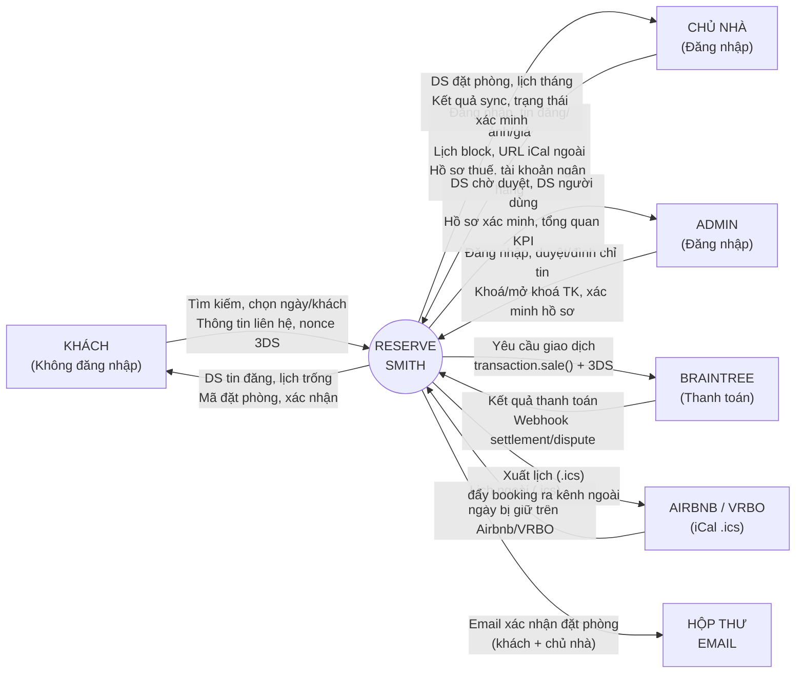
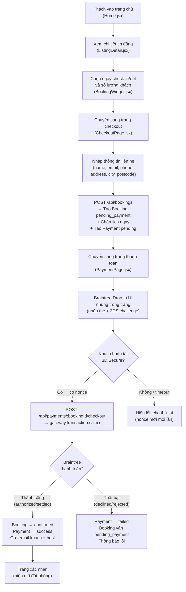

# ReserveSmith — Báo Cáo Dự Án

---

## 1. Lý Do Ra Đời Của Ứng Dụng

### Bối Cảnh Vấn Đề

Thị trường cho thuê lưu trú ngắn hạn tại Việt Nam đang tăng trưởng mạnh mẽ, đặc biệt sau sự bùng nổ của du lịch nội địa và quốc tế. Tuy nhiên, phần lớn chủ nhà — từ hộ gia đình cho thuê phòng, chủ homestay nhỏ lẻ đến chủ villa nghỉ dưỡng — vẫn phụ thuộc hoàn toàn vào các nền tảng quốc tế như Airbnb hay Booking.com để tiếp cận khách hàng. Điều này tạo ra nhiều bất cập:

| Vấn Đề | Ảnh Hưởng |
|---|---|
| Phí hoa hồng cao (15–20% mỗi đơn đặt phòng) | Chủ nhà mất một phần đáng kể doanh thu sau mỗi giao dịch |
| Không kiểm soát được cách hiển thị tin đăng | Chủ nhà không thể tự điều chỉnh cách trình bày hoặc định giá theo ý muốn |
| Phụ thuộc vào chính sách của nền tảng nước ngoài | Tài khoản có thể bị khoá hoặc chính sách thay đổi bất ngờ, ảnh hưởng trực tiếp đến thu nhập |
| Không có quan hệ trực tiếp với khách | Thông tin liên hệ của khách bị ẩn; khách quay lại vẫn phải đặt qua nền tảng trung gian |
| Thiếu phương thức thanh toán phù hợp | Cổng thanh toán quốc tế gây khó khăn cho khách Việt Nam |

### Mục Tiêu Xây Dựng

ReserveSmith được xây dựng nhằm cung cấp cho chủ nhà một **nền tảng đặt phòng tự vận hành, độc lập hoàn toàn** — nơi họ nắm toàn quyền kiểm soát. Cụ thể:

1. **Giảm chi phí trung gian** — mô hình hoa hồng cố định thay vì phí phần trăm theo từng đơn như các nền tảng bên thứ ba.
2. **Sở hữu quan hệ khách hàng** — thông tin liên hệ của khách được thu thập trực tiếp khi thanh toán và lưu trong cơ sở dữ liệu của nền tảng.
3. **Trải nghiệm đặt phòng không rào cản** — khách có thể duyệt và đặt phòng mà không cần tạo tài khoản, giảm thiểu trở ngại chuyển đổi.
4. **Độc lập vận hành** — toàn bộ hệ thống (backend, cơ sở dữ liệu, email, lưu trữ ảnh, thanh toán) chạy trên hạ tầng riêng qua Docker Compose, không phụ thuộc bắt buộc vào bất kỳ dịch vụ SaaS bên thứ ba nào.
5. **Tương thích iCal hai chiều** — chủ nhà vẫn có thể đăng tin trên Airbnb/VRBO và đồng bộ lịch hai chiều để tránh đặt trùng mà không cần từ bỏ các kênh khác.

---

## 2. Các Tính Năng Của Dự Án

### 2.1 Tính Năng Dành Cho Khách (không cần tài khoản)

| Tính Năng | Mô Tả | Trạng Thái |
|---|---|---|
| Duyệt tin đăng | Xem tất cả tin đăng đã được duyệt với ảnh, giá, sức chứa, tiện nghi và vị trí | ✅ Hoàn thành |
| Tìm kiếm & lọc | Lọc theo danh mục, số lượng khách, khoảng giá và ngày còn trống | ✅ Hoàn thành |
| Trang chi tiết tin đăng | Bộ ảnh đầy đủ, danh sách tiện nghi, thông tin phòng, lịch xem ngày trống tương tác | ✅ Hoàn thành |
| Đặt phòng không cần đăng ký | Chỉ cần nhập thông tin liên hệ là đặt được — không cần tạo tài khoản; hệ thống tự tạo tài khoản khách nhẹ ở phía sau | ✅ Hoàn thành |
| Kiểm tra tình trạng phòng thời gian thực | Lịch hiển thị ngày bị chặn/đã đặt; chống đặt trùng được xử lý nguyên tử ở tầng cơ sở dữ liệu | ✅ Hoàn thành |
| Thanh toán bảo mật | Giao diện Braintree Drop-in UI với xác thực 3D Secure bắt buộc | ✅ Hoàn thành |
| Email xác nhận đặt phòng | Email HTML tự động gửi cho khách khi thanh toán thành công | ✅ Hoàn thành |

### 2.2 Tính Năng Dành Cho Chủ Nhà (dashboard đăng nhập)

| Tính Năng | Mô Tả | Trạng Thái |
|---|---|---|
| Quản lý tin đăng (CRUD) | Tạo, chỉnh sửa và xoá tin đăng với tiêu đề, mô tả, danh mục, địa chỉ, sức chứa, số phòng ngủ, giường, phòng tắm, tiện nghi và giá | ✅ Hoàn thành |
| Quản lý ảnh | Tải lên nhiều ảnh cho mỗi tin; ảnh tự động được resize về thumbnail (480 px) và bản lớn (1600 px) định dạng AVIF trên server | ✅ Hoàn thành |
| Giá ngày thường / cuối tuần | Đặt giá cơ bản riêng cho ngày thường và cuối tuần | ✅ Hoàn thành |
| Ghi đè giá theo ngày | Ghi đè giá cho bất kỳ ngày cụ thể nào (ví dụ: ngày lễ, Tết) | ✅ Hoàn thành |
| Phí dọn dẹp | Đặt phí dọn dẹp cố định cộng thêm vào tổng tiền mỗi đơn đặt phòng | ✅ Hoàn thành |
| Quản lý lịch | Giao diện lịch theo tháng — chặn/bỏ chặn ngày thủ công, đặt quy tắc số đêm tối thiểu/tối đa theo từng ngày | ✅ Hoàn thành |
| Nhập iCal (đồng bộ hai chiều) | Dán URL `.ics` từ Airbnb/VRBO để tự động kéo các đặt phòng bên ngoài vào lịch | ✅ Hoàn thành |
| Xuất iCal | Mỗi tin đăng có một link xuất riêng để chủ nhà dán vào Airbnb/VRBO nhằm đẩy đặt phòng của mình ra ngoài | ✅ Hoàn thành |
| Dashboard đặt phòng | Xem khách đến hôm nay, đặt phòng sắp tới và toàn bộ lịch sử đặt phòng | ✅ Hoàn thành |
| Email xác nhận đặt phòng | Email HTML tự động gửi cho chủ nhà khi khách hoàn tất thanh toán | ✅ Hoàn thành |
| Hồ sơ thuế & xác minh | Nộp tên pháp lý, mã số thuế, loại đối tượng nộp thuế và thông tin tài khoản ngân hàng để admin xét duyệt | ✅ Hoàn thành |
| Thông tin tài khoản ngân hàng (payout) | Khai báo sort code + số tài khoản UK để platform chuyển tiền hoa hồng | ✅ Hoàn thành |
|
### 2.3 Tính Năng Dành Cho Admin (dashboard đăng nhập)

| Tính Năng | Mô Tả | Trạng Thái |
|---|---|---|
| Kiểm duyệt tin đăng | Duyệt hoặc đình chỉ tin đăng do chủ nhà tạo; cung cấp lý do khi đình chỉ | ✅ Hoàn thành |
| Quản lý người dùng | Xem tất cả người dùng; khoá hoặc mở khoá tài khoản; cung cấp lý do khi khoá | ✅ Hoàn thành |
| Xác minh chủ nhà | Xem xét hồ sơ thuế/giấy tờ tuỳ thân của chủ nhà; đánh dấu đã xác minh hoặc từ chối kèm ghi chú | ✅ Hoàn thành |
| Tổng quan nền tảng | Dashboard hiển thị các chỉ số chính (tổng tin đăng, đặt phòng, người dùng) | ✅ Hoàn thành |

## 3. Sơ Đồ Ngữ Cảnh (DFD Mức 0)

**Quy tắc sơ đồ ngữ cảnh chuẩn:**
- Hình chữ nhật = Tác nhân bên ngoài (External Entity)
- Hình tròn = Hệ thống (Process 0) — chỉ có **1 tiến trình duy nhất** ở giữa
- Mũi tên có nhãn = Luồng dữ liệu (Data Flow)
- Không vẽ nội bộ hệ thống, không có kho dữ liệu (Data Store)

### Mô Tả Các Tác Nhân

| Tác Nhân | Luồng Vào Hệ Thống | Luồng Ra Khỏi Hệ Thống |
|---|---|---|
| **Khách** | Yêu cầu tìm kiếm/lọc, thông tin liên hệ, nonce thanh toán Braintree Drop-in + 3DS | Danh sách tin đăng, lịch ngày trống, trang chi tiết, mã đặt phòng, xác nhận thanh toán |
| **Chủ Nhà** | Đăng nhập, dữ liệu tin đăng/ảnh/giá/lịch, block ngày thủ công, URL iCal ngoài, hồ sơ thuế/CCCD, tài khoản ngân hàng (payout) | Danh sách đặt phòng, lịch tháng theo từng ngày (giá + trạng thái), kết quả sync iCal, trạng thái xác minh hồ sơ |
| **Admin** | Đăng nhập, quyết định duyệt/đình chỉ tin, khoá/mở khoá tài khoản, xác minh/từ chối hồ sơ thuế | Danh sách tin chờ duyệt (filter theo status), danh sách người dùng, hồ sơ xác minh chủ nhà, KPI tổng quan |
| **Braintree** | Kết quả giao dịch `transaction.sale()` + trạng thái 3D Secure, webhook `transaction_settled`/`transaction_settlement_declined` | Yêu cầu tạo client token, yêu cầu giao dịch `transaction.sale()` với bắt buộc 3DS |
| **Airbnb / VRBO (iCal)** | Dữ liệu lịch bên ngoài (file `.ics` — nhập vào để chặn ngày trùng) | URL xuất lịch `.ics` của nền tảng (đẩy đặt phòng ra kênh ngoài) — bảo mật bằng `icalToken` riêng |
| **Hộp Thư Email** | — | Email HTML xác nhận đặt phòng gửi đến khách (tổng tiền, mã code) và chủ nhà (thông tin khách + breakdown payout) |

---

## 4. Sơ Đồ Luồng Đặt Phòng (Booking Flow)

Mô tả luồng chính từ khi khách chọn phòng đến khi xác nhận thanh toán thành công:

---

